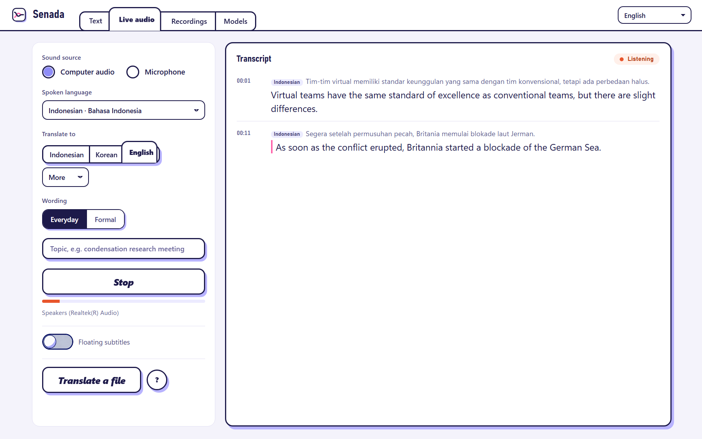
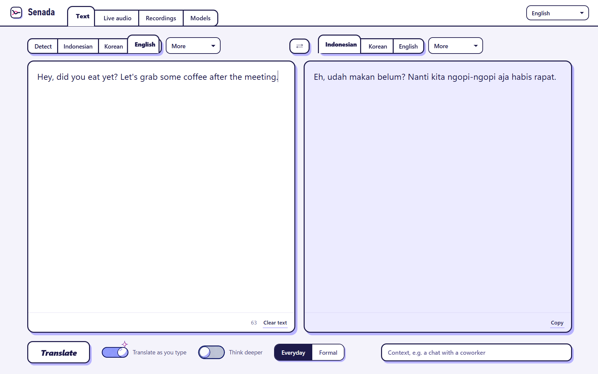

  

<h1 align="center">Senada</h1>

  Translate text and live speech on your Windows PC. No account, no API key, nothing sent online.

  

## What it does

- **Text.** Type or paste, and the translation appears as you type. 202 languages, with Indonesian, Korean
  and English up front.
- **Live audio.** Senada listens to what the computer plays (a video call, a lecture, a film) or to the
  microphone, writes down what is said and translates it. Words show about a second after a sentence ends,
  and the sentence still being spoken shows in grey. If you plug in a headset or switch speakers, it follows.
- **Floating subtitles.** A small bar over any window shows the latest line.
- **Recordings.** Every session is saved as a bilingual transcript you can search and export as text,
  SRT subtitles or a Markdown table. A video or audio file can be translated the same way.
- **Penalar.** An optional local language model (Gemma 4) that translates what was meant rather than word
  for word. It uses the lines before to fix misheard names and terms, knows common slang, and lets you
  choose **Everyday** or **Formal** wording.
- **Your words.** A list of names and terms to spell your way, and your own slang dictionary.
- The app itself speaks Indonesian, English or Korean.

  

## How it works

Everything runs on your computer, using open models downloaded once from the Models page:

| Part | Model | Size |
| --- | --- | --- |
| Hearing | Whisper large-v3 turbo (or small / base) | 0.15 to 1.6 GB |
| Translation | NLLB-200 1.3B (or 600M) | 0.6 to 1.4 GB |
| Penalar, optional | Gemma 4 E4B (or E2B) through llama.cpp | 3.0 to 4.7 GB |

An NVIDIA card with 6 GB holds Whisper turbo and Gemma 4 E4B together. Without one it runs on the CPU,
more slowly.

## Install

You need Windows 10 or 11 (64-bit) and Python 3.12.

1. Download this repository and open the `offline` folder.
2. Run `setup.cmd` once. It creates the Python environment inside that folder.
3. Open Senada from the Start menu or with `Senada.lnk`.
4. On the **Models** page, download a translator and a listener; add Penalar if you want it.

The full guide, in Indonesian, is in [offline/README.md](offline/README.md).

## Credits and licences

Senada is a fork of [**Cicada**](https://github.com/wquguru/cicada) by wquguru (Apache-2.0) and uses its
Linux engine unchanged. The rest of this repository is Cicada's own Mac, Windows, Linux and Android apps;
their README is in [docs/cicada](docs/cicada/README.md).

- Buttons and controls: [Sakuga VFX](https://github.com/finktheartist/sakuga-vfx) by Justin Finkelman (MIT)
- NLLB-200 by Meta: CC-BY-NC 4.0, **non-commercial use only**
- Whisper by OpenAI: MIT
- Gemma 4 by Google: Apache-2.0, run with llama.cpp (MIT)

The code is under the Apache License 2.0 ([LICENSE](LICENSE)). All notices are in
[offline/NOTICE.md](offline/NOTICE.md).
